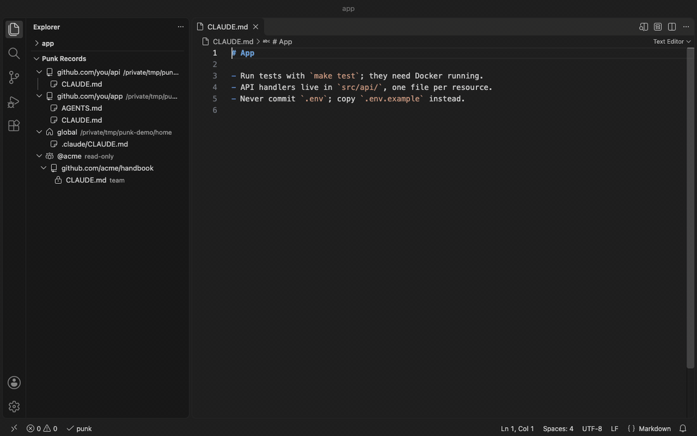
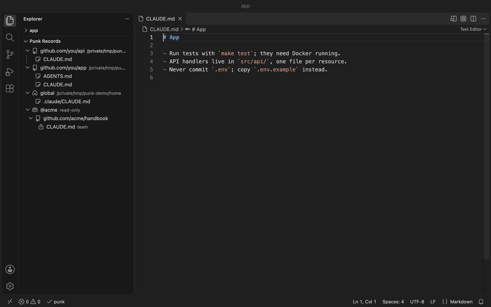
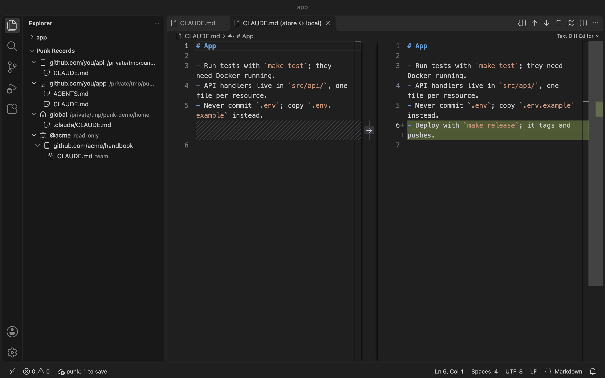
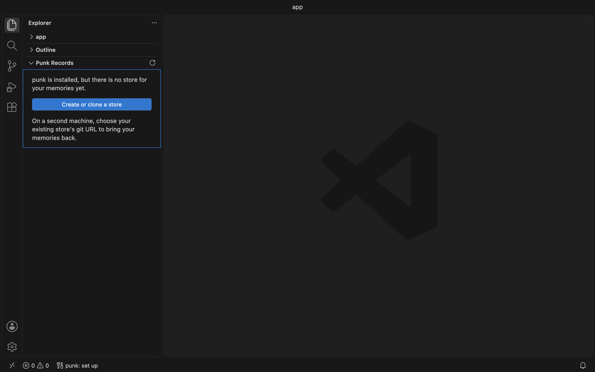

# Punk Records for VS Code

Keeps an eye on [Punk Records](https://github.com/gablooge/punk-records), the store that persists and
syncs your AI agent memories (`CLAUDE.md`, `AGENTS.md`, napkins, rules) across projects and machines.

## Features

- **Status bar.** `✓ punk` when everything is saved and restored; otherwise how many memories wait to
  be saved or restored, or how many conflicts need you. Click it for the actions.
- **Commands** (Command Palette, "Punk Records: ..."): Save memories, Sync, Restore memories,
  Compare with store, Remove duplicate lines, Refresh.
- **Conflicts in the diff view.** "Compare with store" opens the store copy next to your local file in
  VS Code's side-by-side diff.
- **Memories view** in the Explorer: every tracked project and its memory files, plus team stores you
  subscribe to (`punk subscribe`), read-only.
- **Save on file save** (off by default): `punkRecords.saveOnFileSave` runs `punk save` for the
  project when you save one of its memory files.

## Install

- **VS Code:** search "Punk Records" in the Extensions view, or
  `code --install-extension gablooge.punk-records`
  ([Marketplace](https://marketplace.visualstudio.com/items?itemName=gablooge.punk-records)).
- **VSCodium, Cursor and other editors using Open VSX:**
  [open-vsx.org/extension/gablooge/punk-records](https://open-vsx.org/extension/gablooge/punk-records).
- **Offline:** download the `.vsix` from
  [Releases](https://github.com/gablooge/punk-records-vscode/releases), then
  `code --install-extension punk-records-<version>.vsix`.

## Getting started

On first use the extension finds what is missing and offers the next step in the Punk Records view
and the status bar (`punk: set up`): install or upgrade punk (runs `pipx` in a terminal you can
see), create a store or clone your existing one from its git URL, and track the open folder. The
walkthrough **Get started with Punk Records** (Help, Welcome) shows the same steps.

## Requirements

The `punk` command, version 0.4.0 or newer: `pipx install punk-records` (or `pipx upgrade
punk-records`), then `punk init` and `punk track <project>`. If VS Code cannot find `punk`, set
`punkRecords.executable` to the output of `which punk`.

## Settings

| Setting | Default | |
|---|---|---|
| `punkRecords.executable` | `punk` | the punk command or its full path (user settings only) |
| `punkRecords.home` | (empty) | store location; empty means `~/.punk-records` (user settings only) |
| `punkRecords.saveOnFileSave` | `false` | run `punk save` when a memory file is saved |
| `punkRecords.refreshSeconds` | `60` | how often the status bar checks; 0 for only after commands |

The extension only runs the `punk` CLI; it has no other dependencies and does not reach the network
itself (Sync does, through your git remote).

`punkRecords.executable` and `punkRecords.home` are read from your user settings only; a
workspace's `.vscode/settings.json` cannot set them, so opening a repository cannot make the
extension run a program of its choosing. The extension stays off in Restricted Mode (untrusted
workspaces).

## License

MIT
